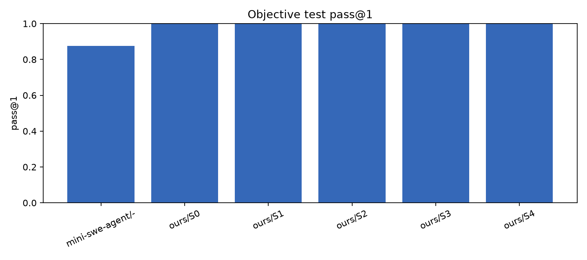
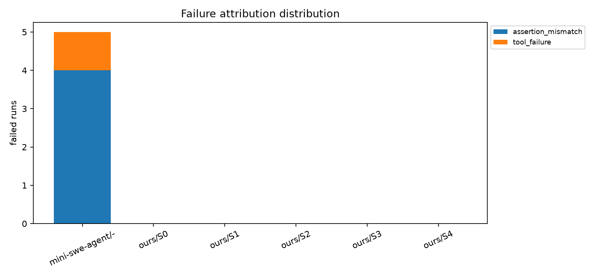
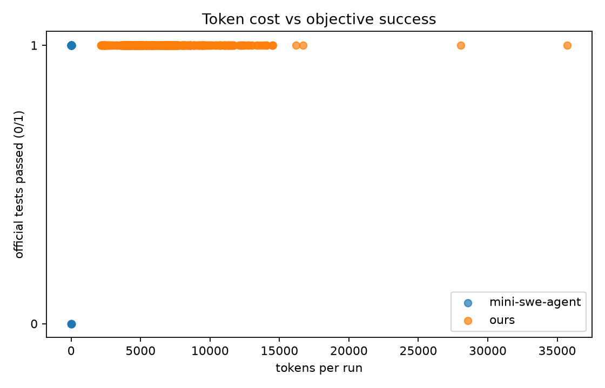

# Agent 横向评测报告：quixbugs-final

生成时间：2026-11-19T12:48:58.548388+00:00  
数据集版本：v1  
数据集 SHA-256：`8255275613efbbc4d670fb94c2e98380adacc3ff056d8b80d9c8ae7a8d38fb16`  
共同题目数：40

> 主指标为最终 patch 在原始源码副本上运行官方 pytest 的结果；未使用 LLM 打分。
> pass@k 的 k 是独立生成次数，Agent 内部重试不计入 k。延迟为步骤耗时，0/缺失值不参与分位数。

## 指标对比

| Agent | 策略 | runs | repeats | pass@1 | pass@k | repeat 均值 | 方差 | Top-1 | Top-3 | token/run | P50 ms | P95 ms | 重试成功率 |
|---|---|---:|---:|---:|---:|---:|---:|---:|---:|---:|---:|---:|---:|
| mini-swe-agent | - | 40 | 1 | 87.50% | 87.50% | 87.50% | N/A | 100.00% | 100.00% | 0.0 | N/A | N/A | N/A |
| ours | S0 | 120 | 3 | 100.00% | 100.00% | 100.00% | 0.000000 | 72.50% | 74.17% | 5266.7 | 4195.0 | 30044.8 | 100.00% |
| ours | S1 | 120 | 3 | 100.00% | 100.00% | 100.00% | 0.000000 | 89.17% | 89.17% | 5255.2 | 3872.0 | 27085.8 | N/A |
| ours | S2 | 120 | 3 | 100.00% | 100.00% | 100.00% | 0.000000 | 92.50% | 92.50% | 6042.0 | 4355.0 | 32642.8 | N/A |
| ours | S3 | 120 | 3 | 100.00% | 100.00% | 100.00% | 0.000000 | 95.83% | 96.67% | 8370.5 | 4525.0 | 36481.8 | 100.00% |
| ours | S4 | 120 | 3 | 100.00% | 100.00% | 100.00% | 0.000000 | 94.17% | 94.17% | 8079.5 | 4824.0 | 35769.4 | N/A |

## 失败归因分布

| Agent | 策略 | 类别 | 失败数 | 失败内占比 |
|---|---|---|---:|---:|
| mini-swe-agent | - | assertion_mismatch | 4 | 80.00% |
| mini-swe-agent | - | tool_failure | 1 | 20.00% |

## 自动对比结论

- `mini-swe-agent/-` 相对 `ours/S0` 的 pass@1 差值为 -12.50 个百分点；失败占比差最大的类别是 `assertion_mismatch`（+80.00 个百分点）。
- `mini-swe-agent/-` 相对 `ours/S1` 的 pass@1 差值为 -12.50 个百分点；失败占比差最大的类别是 `assertion_mismatch`（+80.00 个百分点）。
- `mini-swe-agent/-` 相对 `ours/S2` 的 pass@1 差值为 -12.50 个百分点；失败占比差最大的类别是 `assertion_mismatch`（+80.00 个百分点）。
- `mini-swe-agent/-` 相对 `ours/S3` 的 pass@1 差值为 -12.50 个百分点；失败占比差最大的类别是 `assertion_mismatch`（+80.00 个百分点）。
- `mini-swe-agent/-` 相对 `ours/S4` 的 pass@1 差值为 -12.50 个百分点；失败占比差最大的类别是 `assertion_mismatch`（+80.00 个百分点）。
- `ours/S0` 相对 `ours/S1` 的 pass@1 差值为 +0.00 个百分点；两组均无失败，没有错误分布差异。
- `ours/S0` 相对 `ours/S2` 的 pass@1 差值为 +0.00 个百分点；两组均无失败，没有错误分布差异。
- `ours/S0` 相对 `ours/S3` 的 pass@1 差值为 +0.00 个百分点；两组均无失败，没有错误分布差异。
- `ours/S0` 相对 `ours/S4` 的 pass@1 差值为 +0.00 个百分点；两组均无失败，没有错误分布差异。
- `ours/S1` 相对 `ours/S2` 的 pass@1 差值为 +0.00 个百分点；两组均无失败，没有错误分布差异。
- `ours/S1` 相对 `ours/S3` 的 pass@1 差值为 +0.00 个百分点；两组均无失败，没有错误分布差异。
- `ours/S1` 相对 `ours/S4` 的 pass@1 差值为 +0.00 个百分点；两组均无失败，没有错误分布差异。
- `ours/S2` 相对 `ours/S3` 的 pass@1 差值为 +0.00 个百分点；两组均无失败，没有错误分布差异。
- `ours/S2` 相对 `ours/S4` 的 pass@1 差值为 +0.00 个百分点；两组均无失败，没有错误分布差异。
- `ours/S3` 相对 `ours/S4` 的 pass@1 差值为 +0.00 个百分点；两组均无失败，没有错误分布差异。

## 失效模式聚类（TF-IDF + KMeans）

- 簇 0：3 条；主要类别 `assertion_mismatch`；代表 run `mini-shunting_yard.traj-a81d7d90af`；特征词：num, num num, path, node, input_data。
- 簇 1：1 条；主要类别 `assertion_mismatch`；代表 run `mini-find_in_sorted.traj-ccc568543e`；特征词：binsearch, num, num num, path in, python_programs。
- 簇 2：1 条；主要类别 `assertion_mismatch`；代表 run `mini-longest_common_subsequence.traj-1471f043ce`；特征词：input_data, bcba, test_longest_common_subsequence, expected, input_data expected。

## 典型 bad case

- `mini-swe-agent` / `find_in_sorted` / `assertion_mismatch`：修复位置命中 gold，但最终测试仍出现断言不一致。 [trace](traces/mini-find_in_sorted.traj-ccc568543e.json)
- `mini-swe-agent` / `longest_common_subsequence` / `assertion_mismatch`：修复位置命中 gold，但最终测试仍出现断言不一致。 [trace](traces/mini-longest_common_subsequence.traj-1471f043ce.json)

## LLM 辅助归因人工抽检

- 已抽检：5 条
- 一致率：100.00%
- 本次核对执行者：AI 辅助核对（WorkBuddy），基于失败 trace 的断言报错与工具调用记录逐条复核；非人工抽检。
- 未抽检时不展示或推测一致率；LLM 不干预客观 pass/fail。

## Token 与成功率

