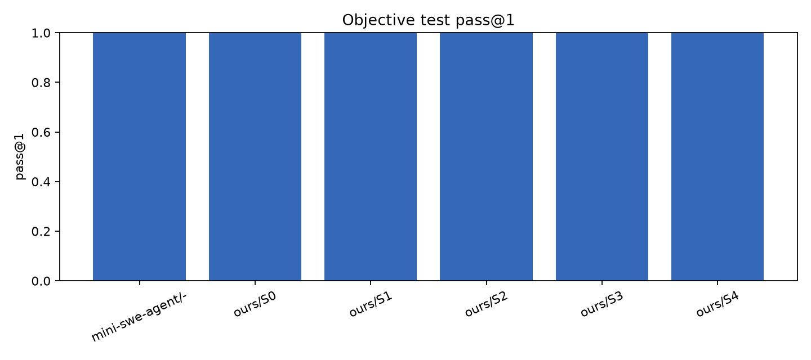
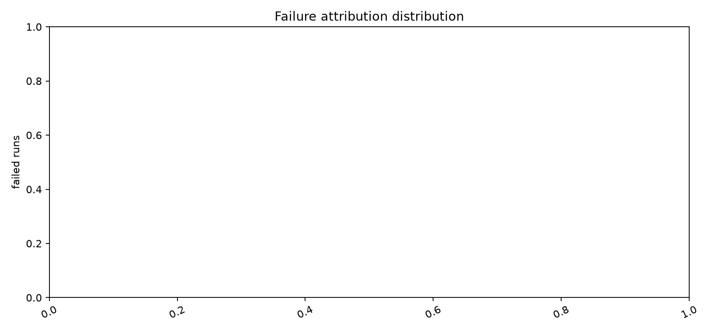

# Agent 横向评测报告：quixbugs-final-q38

生成时间：2026-11-19T14:43:50.660050+00:00  
数据集版本：v1  
数据集 SHA-256：`8255275613efbbc4d670fb94c2e98380adacc3ff056d8b80d9c8ae7a8d38fb16`  
共同题目数：40

> 主指标为最终 patch 在原始源码副本上运行官方 pytest 的结果；未使用 LLM 打分。
> pass@k 的 k 是独立生成次数，Agent 内部重试不计入 k。延迟为步骤耗时，0/缺失值不参与分位数。

## 指标对比

| Agent | 策略 | runs | repeats | pass@1 | pass@k | repeat 均值 | 方差 | Top-1 | Top-3 | token/run | P50 ms | P95 ms | 重试成功率 |
|---|---|---:|---:|---:|---:|---:|---:|---:|---:|---:|---:|---:|---:|
| mini-swe-agent | - | 40 | 1 | 100.00% | 100.00% | 100.00% | N/A | 32.50% | 95.00% | 0.0 | 2323.0 | 13217.2 | N/A |
| ours | S0 | 120 | 3 | 100.00% | 100.00% | 100.00% | 0.000000 | 72.50% | 74.17% | 5266.7 | 4195.0 | 30044.8 | 100.00% |
| ours | S1 | 120 | 3 | 100.00% | 100.00% | 100.00% | 0.000000 | 89.17% | 89.17% | 5255.2 | 3872.0 | 27085.8 | N/A |
| ours | S2 | 120 | 3 | 100.00% | 100.00% | 100.00% | 0.000000 | 92.50% | 92.50% | 6042.0 | 4355.0 | 32642.8 | N/A |
| ours | S3 | 120 | 3 | 100.00% | 100.00% | 100.00% | 0.000000 | 95.83% | 96.67% | 8370.5 | 4525.0 | 36481.8 | 100.00% |
| ours | S4 | 120 | 3 | 100.00% | 100.00% | 100.00% | 0.000000 | 94.17% | 94.17% | 8079.5 | 4824.0 | 35769.4 | N/A |

## 失败归因分布

| Agent | 策略 | 类别 | 失败数 | 失败内占比 |
|---|---|---|---:|---:|

## 自动对比结论

- `mini-swe-agent/-` 相对 `ours/S0` 的 pass@1 差值为 +0.00 个百分点；两组均无失败，没有错误分布差异；但两者过程不同：定位 Top-1 差 -40.00 个百分点，P50 步骤延迟差 -1872.0 ms（pass@1 已触及天花板，差异需看过程指标）。
- `mini-swe-agent/-` 相对 `ours/S1` 的 pass@1 差值为 +0.00 个百分点；两组均无失败，没有错误分布差异；但两者过程不同：定位 Top-1 差 -56.67 个百分点，P50 步骤延迟差 -1549.0 ms（pass@1 已触及天花板，差异需看过程指标）。
- `mini-swe-agent/-` 相对 `ours/S2` 的 pass@1 差值为 +0.00 个百分点；两组均无失败，没有错误分布差异；但两者过程不同：定位 Top-1 差 -60.00 个百分点，P50 步骤延迟差 -2032.0 ms（pass@1 已触及天花板，差异需看过程指标）。
- `mini-swe-agent/-` 相对 `ours/S3` 的 pass@1 差值为 +0.00 个百分点；两组均无失败，没有错误分布差异；但两者过程不同：定位 Top-1 差 -63.33 个百分点，P50 步骤延迟差 -2202.0 ms（pass@1 已触及天花板，差异需看过程指标）。
- `mini-swe-agent/-` 相对 `ours/S4` 的 pass@1 差值为 +0.00 个百分点；两组均无失败，没有错误分布差异；但两者过程不同：定位 Top-1 差 -61.67 个百分点，P50 步骤延迟差 -2501.0 ms（pass@1 已触及天花板，差异需看过程指标）。
- `ours/S0` 相对 `ours/S1` 的 pass@1 差值为 +0.00 个百分点；两组均无失败，没有错误分布差异；但两者过程不同：定位 Top-1 差 -16.67 个百分点，平均 token/题 差 +11.5，P50 步骤延迟差 +323.0 ms（pass@1 已触及天花板，差异需看过程指标）。
- `ours/S0` 相对 `ours/S2` 的 pass@1 差值为 +0.00 个百分点；两组均无失败，没有错误分布差异；但两者过程不同：定位 Top-1 差 -20.00 个百分点，平均 token/题 差 -775.3，P50 步骤延迟差 -160.0 ms（pass@1 已触及天花板，差异需看过程指标）。
- `ours/S0` 相对 `ours/S3` 的 pass@1 差值为 +0.00 个百分点；两组均无失败，没有错误分布差异；但两者过程不同：定位 Top-1 差 -23.33 个百分点，平均 token/题 差 -3103.8，P50 步骤延迟差 -330.0 ms（pass@1 已触及天花板，差异需看过程指标）。
- `ours/S0` 相对 `ours/S4` 的 pass@1 差值为 +0.00 个百分点；两组均无失败，没有错误分布差异；但两者过程不同：定位 Top-1 差 -21.67 个百分点，平均 token/题 差 -2812.8，P50 步骤延迟差 -629.0 ms（pass@1 已触及天花板，差异需看过程指标）。
- `ours/S1` 相对 `ours/S2` 的 pass@1 差值为 +0.00 个百分点；两组均无失败，没有错误分布差异；但两者过程不同：定位 Top-1 差 -3.33 个百分点，平均 token/题 差 -786.8，P50 步骤延迟差 -483.0 ms（pass@1 已触及天花板，差异需看过程指标）。
- `ours/S1` 相对 `ours/S3` 的 pass@1 差值为 +0.00 个百分点；两组均无失败，没有错误分布差异；但两者过程不同：定位 Top-1 差 -6.67 个百分点，平均 token/题 差 -3115.3，P50 步骤延迟差 -653.0 ms（pass@1 已触及天花板，差异需看过程指标）。
- `ours/S1` 相对 `ours/S4` 的 pass@1 差值为 +0.00 个百分点；两组均无失败，没有错误分布差异；但两者过程不同：定位 Top-1 差 -5.00 个百分点，平均 token/题 差 -2824.3，P50 步骤延迟差 -952.0 ms（pass@1 已触及天花板，差异需看过程指标）。
- `ours/S2` 相对 `ours/S3` 的 pass@1 差值为 +0.00 个百分点；两组均无失败，没有错误分布差异；但两者过程不同：定位 Top-1 差 -3.33 个百分点，平均 token/题 差 -2328.5，P50 步骤延迟差 -170.0 ms（pass@1 已触及天花板，差异需看过程指标）。
- `ours/S2` 相对 `ours/S4` 的 pass@1 差值为 +0.00 个百分点；两组均无失败，没有错误分布差异；但两者过程不同：定位 Top-1 差 -1.67 个百分点，平均 token/题 差 -2037.5，P50 步骤延迟差 -469.0 ms（pass@1 已触及天花板，差异需看过程指标）。
- `ours/S3` 相对 `ours/S4` 的 pass@1 差值为 +0.00 个百分点；两组均无失败，没有错误分布差异；但两者过程不同：定位 Top-1 差 +1.67 个百分点，平均 token/题 差 +291.0，P50 步骤延迟差 -299.0 ms（pass@1 已触及天花板，差异需看过程指标）。

## 失效模式聚类（TF-IDF + KMeans）

没有失败 run，未生成聚类。

## 典型 bad case

没有失败 run。

## 归因结果人工抽检

- 已抽检：0 条
- 一致率：N/A
- 抽检方式：逐条核对失败 trace 的断言报错与工具调用记录。
- 未抽检时不展示或推测一致率；归因只做失败分类，不干预客观 pass/fail。

## Token 与成功率

