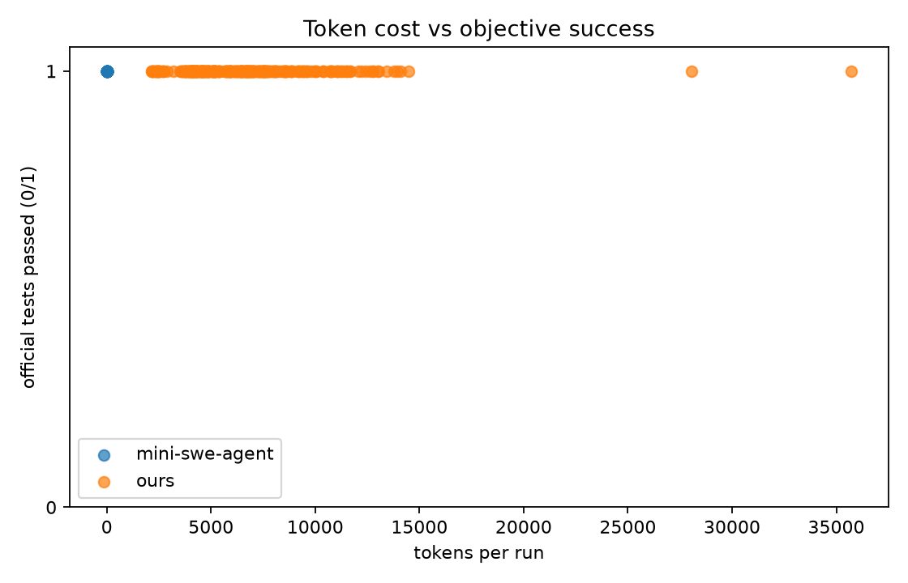

# Agent 横向评测报告：quixbugs-final-q38

生成时间：2026-11-19T13:53:13.323958+00:00  
数据集版本：v1  
数据集 SHA-256：`8255275613efbbc4d670fb94c2e98380adacc3ff056d8b80d9c8ae7a8d38fb16`  
共同题目数：24

> 主指标为最终 patch 在原始源码副本上运行官方 pytest 的结果；未使用 LLM 打分。
> pass@k 的 k 是独立生成次数，Agent 内部重试不计入 k。延迟为步骤耗时，0/缺失值不参与分位数。

> 警告：ours/S0 有 16 题未纳入横向对比（非共同题）。
> 警告：ours/S1 有 16 题未纳入横向对比（非共同题）。
> 警告：ours/S2 有 16 题未纳入横向对比（非共同题）。
> 警告：ours/S3 有 16 题未纳入横向对比（非共同题）。
> 警告：ours/S4 有 16 题未纳入横向对比（非共同题）。

## 指标对比

| Agent | 策略 | runs | repeats | pass@1 | pass@k | repeat 均值 | 方差 | Top-1 | Top-3 | token/run | P50 ms | P95 ms | 重试成功率 |
|---|---|---:|---:|---:|---:|---:|---:|---:|---:|---:|---:|---:|---:|
| mini-swe-agent | - | 24 | 1 | 100.00% | 100.00% | 100.00% | N/A | 37.50% | 100.00% | 0.0 | 2136.5 | 12666.0 | N/A |
| ours | S0 | 72 | 3 | 100.00% | 100.00% | 100.00% | 0.000000 | 70.83% | 72.22% | 5164.3 | 4401.0 | 30672.5 | 100.00% |
| ours | S1 | 72 | 3 | 100.00% | 100.00% | 100.00% | 0.000000 | 90.28% | 90.28% | 5295.9 | 3913.5 | 38088.2 | N/A |
| ours | S2 | 72 | 3 | 100.00% | 100.00% | 100.00% | 0.000000 | 90.28% | 90.28% | 5939.9 | 4222.0 | 37267.0 | N/A |
| ours | S3 | 72 | 3 | 100.00% | 100.00% | 100.00% | 0.000000 | 94.44% | 95.83% | 8286.6 | 4418.0 | 38602.4 | 100.00% |
| ours | S4 | 72 | 3 | 100.00% | 100.00% | 100.00% | 0.000000 | 95.83% | 95.83% | 7856.8 | 4914.5 | 39287.6 | N/A |

## 失败归因分布

| Agent | 策略 | 类别 | 失败数 | 失败内占比 |
|---|---|---|---:|---:|

## 自动对比结论

- `mini-swe-agent/-` 相对 `ours/S0` 的 pass@1 差值为 +0.00 个百分点；两组均无失败，没有错误分布差异。
- `mini-swe-agent/-` 相对 `ours/S1` 的 pass@1 差值为 +0.00 个百分点；两组均无失败，没有错误分布差异。
- `mini-swe-agent/-` 相对 `ours/S2` 的 pass@1 差值为 +0.00 个百分点；两组均无失败，没有错误分布差异。
- `mini-swe-agent/-` 相对 `ours/S3` 的 pass@1 差值为 +0.00 个百分点；两组均无失败，没有错误分布差异。
- `mini-swe-agent/-` 相对 `ours/S4` 的 pass@1 差值为 +0.00 个百分点；两组均无失败，没有错误分布差异。
- `ours/S0` 相对 `ours/S1` 的 pass@1 差值为 +0.00 个百分点；两组均无失败，没有错误分布差异。
- `ours/S0` 相对 `ours/S2` 的 pass@1 差值为 +0.00 个百分点；两组均无失败，没有错误分布差异。
- `ours/S0` 相对 `ours/S3` 的 pass@1 差值为 +0.00 个百分点；两组均无失败，没有错误分布差异。
- `ours/S0` 相对 `ours/S4` 的 pass@1 差值为 +0.00 个百分点；两组均无失败，没有错误分布差异。
- `ours/S1` 相对 `ours/S2` 的 pass@1 差值为 +0.00 个百分点；两组均无失败，没有错误分布差异。
- `ours/S1` 相对 `ours/S3` 的 pass@1 差值为 +0.00 个百分点；两组均无失败，没有错误分布差异。
- `ours/S1` 相对 `ours/S4` 的 pass@1 差值为 +0.00 个百分点；两组均无失败，没有错误分布差异。
- `ours/S2` 相对 `ours/S3` 的 pass@1 差值为 +0.00 个百分点；两组均无失败，没有错误分布差异。
- `ours/S2` 相对 `ours/S4` 的 pass@1 差值为 +0.00 个百分点；两组均无失败，没有错误分布差异。
- `ours/S3` 相对 `ours/S4` 的 pass@1 差值为 +0.00 个百分点；两组均无失败，没有错误分布差异。

## 失效模式聚类（TF-IDF + KMeans）

没有失败 run，未生成聚类。

## 典型 bad case

没有失败 run。

## 归因结果人工抽检

- 已抽检：0 条
- 一致率：N/A
- 抽检方式：逐条核对失败 trace 的断言报错与工具调用记录。
- 未抽检时不展示或推测一致率；归因只做失败分类，不干预客观 pass/fail。

## Token 与成功率

