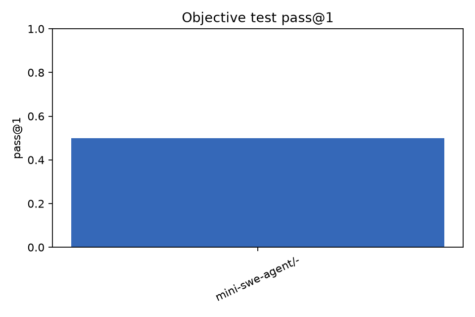
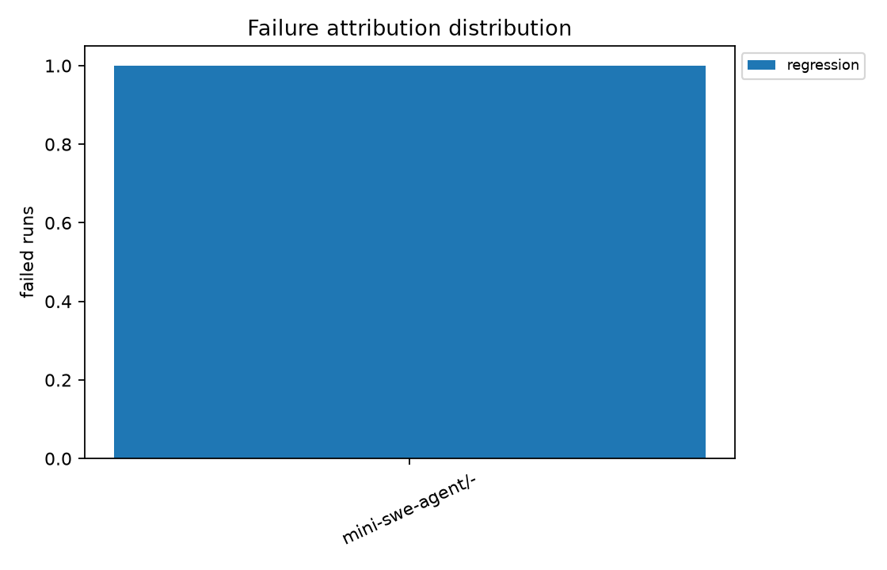
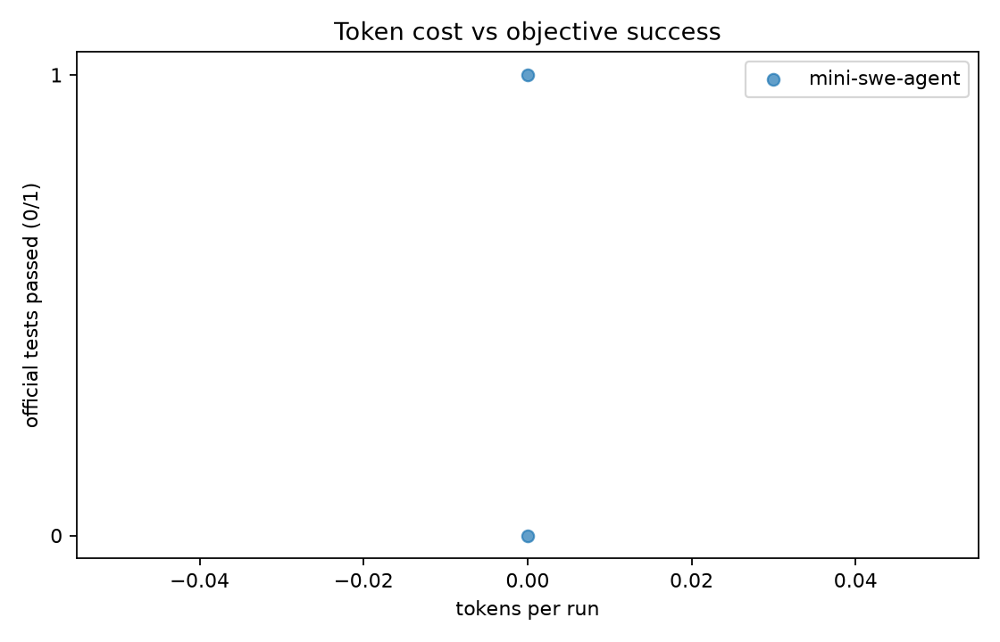

# Agent 横向评测报告：swebench-lite-harness-v1

生成时间：2026-11-21T13:07:01.470590+00:00  
数据集版本：SWE-bench-Lite/4.1, SWE-bench-Lite/5.2  
数据集 SHA-256：`2be4b05cf8e750c409b1c73c71c850d2d4f9afcf627aef501221c627f6973ce2`  
共同题目数：2

> 主指标为 SWE-bench 官方 harness 在对应镜像容器内运行 FAIL_TO_PASS/PASS_TO_PASS 的判定结果（resolved）；未使用 LLM 打分。
> pass@k 的 k 是独立生成次数，Agent 内部重试不计入 k。延迟为步骤耗时，0/缺失值不参与分位数。

## 指标对比

| Agent | 策略 | runs | repeats | pass@1 | pass@k | repeat 均值 | 方差 | Top-1 | Top-3 | token/run | P50 ms | P95 ms | 重试成功率 |
|---|---|---:|---:|---:|---:|---:|---:|---:|---:|---:|---:|---:|---:|
| mini-swe-agent | - | 2 | 1 | 50.00% | 50.00% | 50.00% | N/A | 0.00% | 0.00% | 0.0 | N/A | N/A | N/A |

## 失败归因分布

| Agent | 策略 | 类别 | 失败数 | 失败内占比 |
|---|---|---|---:|---:|
| mini-swe-agent | - | regression | 1 | 100.00% |

## 自动对比结论

当前只有一个 Agent/策略分组，无法给出横向差异结论。

## 失效模式聚类（TF-IDF + KMeans）

- 簇 0：1 条；主要类别 `regression`；代表 run `mini-pytest-6116.traj-54d476e08b`；特征词：num, path, action_run_test, action_run_test action_run_test, failed。

## 典型 bad case

- `mini-swe-agent` / `pytest-dev__pytest-6116` / `regression`：最终测试中既有历史失败消失，又出现了此前从未失败的新测试。 [trace](traces/mini-pytest-6116.traj-54d476e08b.json)

## 归因结果人工抽检

- 已抽检：1 条
- 一致率：0.00%
- 抽检方式：逐条核对失败 trace 的断言报错与工具调用记录。
- 未抽检时不展示或推测一致率；归因只做失败分类，不干预客观 pass/fail。

## Token 与成功率

